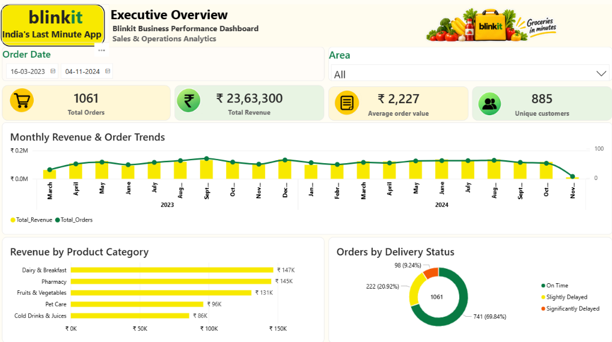
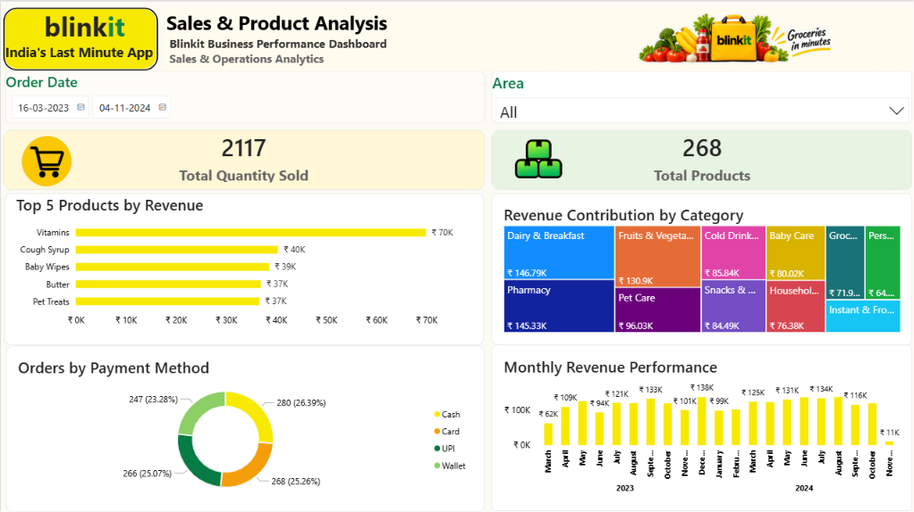
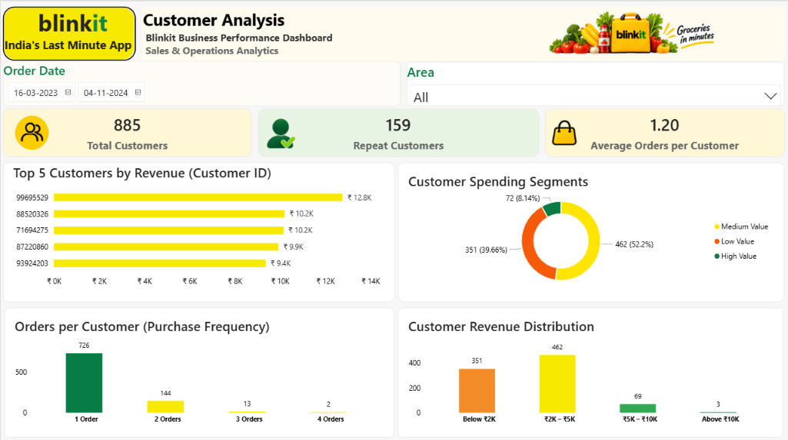
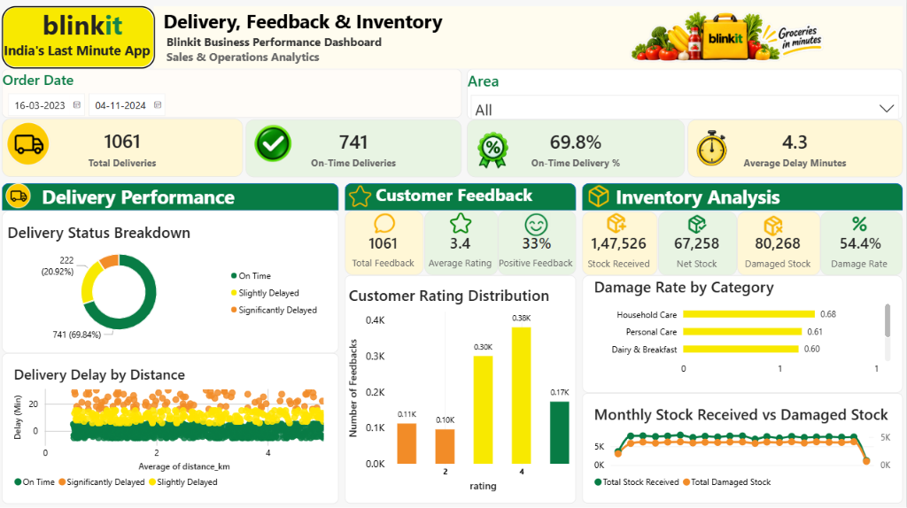

# Blinkit – E-commerce Sales & Business Analytics

An end-to-end data analytics project exploring e-commerce sales, customer behaviour, product performance, delivery operations, customer feedback and inventory using MySQL and Power BI.

## Project Overview

This project analyses Blinkit e-commerce data to understand business performance and identify insights that can support data-driven decision-making.

The analysis uses SQL for data exploration and transformation, and Power BI to build an interactive dashboard covering key business areas.

## Business Objectives

- Analyse overall sales performance and revenue trends.
- Identify top-performing products and product categories.
- Understand customer purchasing behaviour and spending patterns.
- Evaluate delivery performance and delays.
- Analyse customer ratings and feedback sentiment.
- Examine inventory levels and reported damaged stock.

## Tools & Technologies

| Tool | Purpose |
|---|---|
| MySQL | Data querying and analysis |
| Power BI | Interactive dashboard development |
| DAX | Measures and calculated columns |
| Power Query | Data cleaning and transformation |
| Microsoft Excel | Data inspection and preparation |

## Dataset

The project uses a Blinkit-related e-commerce dataset containing seven tables:

1. `blinkit_orders`
2. `blinkit_order_items`
3. `blinkit_products`
4. `blinkit_customers`
5. `blinkit_delivery_performance`
6. `blinkit_customer_feedback`
7. `blinkit_inventory`

*Dataset source and attribution: [Add the original dataset source link here before publishing.]*

## SQL Analysis

SQL techniques used in this project include:

- Joins
- Aggregate functions
- Common Table Expressions (CTEs)
- Subqueries
- Window functions
- Ranking and analytical functions
- Date-based analysis

## Power BI Dashboard

The interactive dashboard contains four analytical pages:

### 1. Executive Overview
- Total Revenue
- Total Orders
- Average Order Value
- Unique Customers
- Overall sales performance

### 2. Sales & Product Analysis
- Revenue by product category
- Product performance
- Sales trends
- Payment method analysis
- Geographical sales analysis

### 3. Customer Analysis
- Customer purchasing frequency
- Repeat customer analysis
- Customer spending segments
- Customer behaviour patterns

### 4. Delivery, Feedback & Inventory
- Delivery performance
- Delivery delay analysis
- Customer ratings and feedback sentiment
- Inventory and damaged stock analysis

## Dashboard Preview

### 1. Executive Overview


### 2. Sales & Product Analysis


### 3. Customer Analysis


### 4. Delivery, Feedback & Inventory


## Key Skills Demonstrated

- Data cleaning and transformation
- Relational data analysis using MySQL
- Writing analytical SQL queries
- Data modelling
- DAX measure development
- Interactive dashboard design
- KPI tracking and business analysis
- Translating data into business insights

## Repository Structure

```text
Blinkit-Ecommerce-Sales-Analytics/
│
├── README.md
├── SQL/
│   └── Blinkit_Sales_Analysis.sql
│
├── PowerBI/
│   └── Blinkit_Dashboard.pbix
│
├── Screenshots/
│   ├── Executive_Overview.png
│   ├── Sales_Product_Analysis.png
│   ├── Customer_Analysis.png
│   └── Delivery_Feedback_Inventory.png
│
└── Dataset/
    └── README.md
```

## Author

**Purva Pawaskar**
